  <picture>
    <source media="(prefers-reduced-motion: reduce)" srcset="./assets/hero-banner-still.svg" />
    
  </picture>

<h2 align="center">From solving everyday problems to architecting ambitious systems.</h2>

  <strong>Software Engineer · AI Systems Builder · Cybersecurity · Full-Stack &amp; Cloud Engineering</strong> 
  Founder &amp; Managing Director, <a href="https://www.codesphereug.com">Codesphere Innovations (U) Limited</a> &nbsp;·&nbsp; Kampala, Uganda

  
  
  
  

---

## The person behind the systems

*My journey has never been about collecting technologies. It has been about using them to build things that matter — from practical business tools, through engineering leadership, to AI, cybersecurity, real-time platforms and open source.*

**[Explore my engineering portfolio](https://github.com/codesphere-u/codesphere-portfolio)** · **[See Cyber Dragon](https://github.com/codesphere-u/cyber-dragon)** · **[Explore Auralis Local](https://github.com/codesphere-u/auralis-local)**

## About Me

I am **Akandwanaho Ivan Alvin** (commonly known as **Alvin**), a Ugandan software engineer, cybersecurity practitioner, full-stack developer, and technology entrepreneur based in Kampala, Uganda.

I build intelligent, secure, and scalable digital products spanning artificial intelligence, full-stack web and mobile platforms, defensive cybersecurity, financial technology, and cloud systems. My work focuses on solving real operational problems—particularly in African markets—while architecting open-source systems and developer tools engineered for global standards.

I believe great engineering combines technical depth, practical usefulness, security by design, and clear architectural trade-offs.

---

## My Engineering Journey

  <picture>
    <source media="(prefers-reduced-motion: reduce)" srcset="./assets/career-timeline-still.svg" />
    
  </picture>

My career has progressed from building foundational business software and independent engineering systems into technical leadership, company building, and open-source systems architecture:

1. **Foundation & Applied Engineering:** Studied at **ISBAT University** (Uganda) while independently building operational software systems across retail, pharmacy, hospitality, hardware, and logistics domains.
2. **Entrepreneurship (`4codex Technologies`):** Founded **4codex Technologies**, delivering custom web engineering, cybersecurity, automation, and business software solutions.
3. **Technical Leadership (`Waanverse Labs Inc.`):** Served as **Chief Technology Officer (CTO) and Head of Engineering** at **Waanverse Labs Inc.** (departed March 2025), leading technical strategy, system architecture, and engineering workflows.
4. **Business & Engineering Leadership (`Codesphere Innovations (U) Limited`):** Serving as **Founder and Managing Director** of **Codesphere Innovations (U) Limited**, combining hands-on software architecture with company leadership, AI-enabled product engineering, cloud solutions, and cybersecurity.
5. **Marketplace Product Engineering (`Funa Gigs` — `Jaminsa Ventures Limited`):** Serving as **Founder and Project Lead** for **Funa Gigs** (a digital services marketplace under **Jaminsa Ventures Limited**), architecting Flutter mobile apps, real-time job matching, Instant Hire workflows, location-based discovery, payment integrations, and trust/safety controls.
6. **Advanced Systems & Open Source:** Designing and maintaining verifiable open-source flagships across local AI inference, multi-agent governance, AI security firewalls, double-entry financial ledgers, and distributed observability.

---

## Professional Experience & Leadership

| Role | Organization | Scope & Engineering Focus | Status |
| :--- | :--- | :--- | :---: |
| **Founder & Managing Director** | **[Codesphere Innovations (U) Limited](https://www.codesphereug.com)** | Custom software architecture, AI-powered applications, web/mobile platforms, cybersecurity, cloud infrastructure, and digital transformation. | **Current** |
| **Founder & Project Lead** | **Funa Gigs** *(Jaminsa Ventures Limited)* | Full-stack marketplace architecture, Flutter mobile engineering, real-time matching, live location workflows, payment integrations, identity verification, and RBAC admin tooling. | **Current** |
| **CTO & Head of Engineering** | **Waanverse Labs Inc.** | Technical strategy, software architecture, engineering management, development workflows, and product delivery. | **Former** *(until Mar 2025)* |
| **Founder** | **4codex Technologies** | Software development, web application engineering, cybersecurity, automation, and technical consultancy. | **Historical Venture** |

- **Education:** Studied at **ISBAT University**, Uganda, complemented by continuous independent systems engineering and applied research.

---

## The Codesphere Agentic Stack (Proof-Carrying AI Agent Infrastructure)

I design and maintain an interoperable, zero-cloud-dependency suite of **9 Model Context Protocol (MCP) & Autonomous Agent Infrastructure systems** unified under **[`nexus-aegis`](https://github.com/codesphere-u/nexus-aegis)** (*Proof-Carrying Agent Execution*):

| Layer | Repository | Core Engineering Guarantee | Verified Proof |
| :--- | :--- | :--- | :--- |
| **0. Attestation Kernel** | **[`nexus-aegis`](https://github.com/codesphere-u/nexus-aegis)** | 7-gate Proof-Carrying Agent Execution (PCAE) + RFC 6962 (`0x00`/`0x01`) SHA-256 Merkle proofs | `100%` recall (`0.27 ms` P50) · `245/245` proofs · `77` tests |
| **1. Memory (`v1.1`)** | **[`cortex-mcp`](https://github.com/codesphere-u/cortex-mcp)** | Bi-temporal knowledge graph (`valid_from` / `valid_until`), contradiction auditor & TruthGate export | `100%` stale-fact suppression · `84` tests |
| **2. Routing (`v1.1`)** | **[`synapse-router`](https://github.com/codesphere-u/synapse-router)** | Pareto cost/latency router (`FAST_LOCAL` → `FRONTIER`), sliding-window rate governor & SimHash cache | `90.59%` USD cost saved · `0.74 ms` P50 · `77` tests |
| **3. Swarm DAG** | **[`swarmweaver`](https://github.com/codesphere-u/swarmweaver)** | Conflict-aware parallel wave planner, file-scope RW/WW leases & SHA-256 crash-safe resume | `0` race conditions · `70%` tokens saved · `65` tests |
| **4. Security** | **[`agentshield`](https://github.com/codesphere-u/agentshield)** | OWASP 2026 prompt-injection detector, capability firewall (Shell/FS/SSRF/SQLi) & egress redactor | `100%` recall / `0%` FPR (25 scenarios) · `42` tests |
| **5. Flight Recorder (`v1.1`)** | **[`agentflight`](https://github.com/codesphere-u/agentflight)** | SHA-256 cassette replay (`$0` CI), trajectory regression diff, W3C OTel export & 10-rule MCP linter | `2.83 µs/span` (`353k spans/s`) · `90` tests |
| **6. Code Repair (`v1.1`)** | **[`patchpilot`](https://github.com/codesphere-u/patchpilot)** | Stack-trace + AST call-graph fault localizer, unified git diff parser & 8-rule anti-reward-hacking guard | `100%` Top-1 (`-96.6%` tokens) · `73` tests |
| **7. Grounding** | **[`truthgate`](https://github.com/codesphere-u/truthgate)** | Deterministic citation-span NLI entailment, polarity/numeric verifier & AST symbol grounder (`TG001`–`TG008`) | `100%` precision/recall (`0.115 ms` P50) · `67` tests |
| **8. Governance** | **[`ARGUS-AI`](https://github.com/codesphere-u/ARGUS-AI)** | 7-agent adversarial deliberation committee with unilateral Devil's Advocate veto & `PointInTimeGuard` | `100%` trap veto precision · `61` tests |

---

## Featured Open-Source Projects (15 Flagship & Domain Systems · 931 Verified Tests)

<table>
  <tr>
    <td colspan="2" valign="top">
      <h3>🌟 Unified Flagship: <a href="https://github.com/codesphere-u/nexus-aegis">🛡️ Nexus Aegis v1.0 — Proof-Carrying Autonomous Agent Kernel &amp; RFC 6962 PR Attestation Engine</a></h3>
      
Introduces <strong>Proof-Carrying Agent Execution (PCAE)</strong>: evaluates autonomous agent runs across 7 deterministic safety, budget, concurrency, trajectory, AST anti-reward-hacking, and citation-grounding gates in <code>0.27 ms</code> P50, and compiles an <strong>RFC 6962 domain-separated binary SHA-256 Merkle tree</strong> (<code>0x00</code> leaf / <code>0x01</code> internal node) with <code>O(log N)</code> selective-disclosure inclusion proofs and drop-in GitHub Pull Request Attestation Cards.

      

        <code>Python</code> <code>Proof-Carrying Code</code> <code>RFC 6962 Merkle Proofs</code> <code>7-Gate PCAE Kernel</code> <code>MCP JSON-RPC 2.0</code> 
        <a href="https://github.com/codesphere-u/nexus-aegis/releases/tag/v1.0.0"><strong>Release v1.0.0 ↗</strong></a> &nbsp;·&nbsp; <a href="https://github.com/codesphere-u/nexus-aegis/actions">77 Passing Tests (100% Recall · 245/245 Merkle Proofs Verified)</a>
      

    </td>
  </tr>
  <tr>
    <td width="50%" valign="top">
      <h3>1. <a href="https://github.com/codesphere-u/swarmweaver">🐝 SwarmWeaver v1.0</a></h3>
      
<strong>Multi-Agent DAG Orchestrator, File-Lease Conflict Guard &amp; Checkpoint Resume Engine</strong>

      
Compiles multi-agent task graphs into conflict-free parallel execution waves via greedy graph coloring over read/write globs (<code>0</code> race conditions across 50 conflicting parallel tasks), enforces <code>SHARED_READ</code> / <code>EXCLUSIVE_WRITE</code> file leases, and journals completed nodes in a SHA-256 hash chain for <code>0.0072 ms/node</code> crash-safe resume (<code>70%</code> tokens saved).

      

        <code>Python</code> <code>DAG Scheduler</code> <code>File Leases</code> <code>Checkpoint Resume</code> <code>MCP</code> 
        <a href="https://github.com/codesphere-u/swarmweaver/releases/tag/v1.0.0"><strong>Release v1.0.0 ↗</strong></a> &nbsp;·&nbsp; <a href="https://github.com/codesphere-u/swarmweaver/actions">65 Passing Tests (0 Race Conditions)</a>
      

    </td>
    <td width="50%" valign="top">
      <h3>2. <a href="https://github.com/codesphere-u/truthgate">🔍 TruthGate v1.0</a></h3>
      
<strong>Deterministic Agent Hallucination Auditor, Citation Entailment &amp; AST Symbol Grounder</strong>

      
Audits AI agent responses in <code>0.115 ms</code> P50 across 8 deterministic rules (<code>TG001</code>–<code>TG008</code>)—catching phantom citations, negation/antonym polarity inversions, numeric/currency drift, out-of-bounds line ranges, and hallucinated workspace AST symbols (<code>100%</code> recall, <code>0%</code> FPR)—and compiles surgical self-repair prompts.

      

        <code>Python</code> <code>Citation NLI</code> <code>AST Grounding</code> <code>LLM Guardrails</code> <code>MCP</code> 
        <a href="https://github.com/codesphere-u/truthgate/releases/tag/v1.0.0"><strong>Release v1.0.0 ↗</strong></a> &nbsp;·&nbsp; <a href="https://github.com/codesphere-u/truthgate/actions">67 Passing Tests (100% Recall · 0% FPR)</a>
      

    </td>
  </tr>
  <tr>
    <td width="50%" valign="top">
      <h3>3. <a href="https://github.com/codesphere-u/patchpilot">🔧 PatchPilot v1.1</a></h3>
      
<strong>Autonomous Code Repair, AST Fault Localization &amp; Anti-Reward-Hacking Verifier</strong>

      
Localizes software faults via stack-trace + AST call-graph + BM25 ranking (<code>100%</code> Top-1 accuracy across 25 scenarios, <code>96.6%</code> prompt token reduction), parses multi-file unified git diffs, blocks reward-hacking patches across 8 AST rules (<code>RH001</code>–<code>RH008</code>, <code>100%</code> recall / <code>0%</code> FPR), and exports canonical Nexus Aegis G5 attestation leaves.

      

        <code>Python</code> <code>AST Verifier</code> <code>Diff Parser</code> <code>Nexus Aegis G5</code> <code>MCP JSON-RPC 2.0</code> 
        <a href="https://github.com/codesphere-u/patchpilot/releases/tag/v1.1.0"><strong>Release v1.1.0 ↗</strong></a> &nbsp;·&nbsp; <a href="https://github.com/codesphere-u/patchpilot/actions">73 Passing Tests (100% Top-1 Localization)</a>
      

    </td>
    <td width="50%" valign="top">
      <h3>4. <a href="https://github.com/codesphere-u/synapse-router">⚡ Synapse Router v1.1</a></h3>
      
<strong>Cost-Aware Multi-Model AI Agent Router, Sliding Rate Governor &amp; Aegis Bridge</strong>

      
Routes agent prompts across <code>FAST_LOCAL</code>, <code>BALANCED</code>, and <code>FRONTIER_REASONING</code> tiers using an 8-feature complexity classifier, sliding-window RPM/TPM rate governor, confidence-gated cascade escalation (<code>90.59%</code> USD cost reduction, <code>0.74 ms</code> P50 routing latency), a 3-state circuit breaker (<code>100%</code> HTTP 429 failover), and canonical Nexus Aegis G2 leaf exports.

      

        <code>Python</code> <code>LLM Gateway</code> <code>Rate Governor</code> <code>Nexus Aegis G2</code> <code>MCP</code> 
        <a href="https://github.com/codesphere-u/synapse-router/releases/tag/v1.1.0"><strong>Release v1.1.0 ↗</strong></a> &nbsp;·&nbsp; <a href="https://github.com/codesphere-u/synapse-router/actions">77 Passing Tests (90.59% Cost Reduction)</a>
      

    </td>
  </tr>
  <tr>
    <td width="50%" valign="top">
      <h3>5. <a href="https://github.com/codesphere-u/cortex-mcp">🧠 Cortex MCP v1.1</a></h3>
      
<strong>Bi-Temporal Knowledge Graph, Contradiction Auditor &amp; Cross-Agent Memory MCP Server</strong>

      
Zero-cloud Model Context Protocol (JSON-RPC 2.0) server that eliminates context amnesia across Claude Code, Cursor, Windsurf, and Antigravity using bi-temporal fact supersession, semantic/polarity contradiction auditing, TruthGate source export, and token-budgeted context compilation.

      

        <code>Python</code> <code>MCP JSON-RPC 2.0</code> <code>Bi-Temporal Graph</code> <code>BM25 RAG</code> 
        <a href="https://github.com/codesphere-u/cortex-mcp/releases/tag/v1.1.0"><strong>Release v1.1.0 ↗</strong></a> &nbsp;·&nbsp; <a href="https://github.com/codesphere-u/cortex-mcp/actions">85 Passing Tests (100% Stale Suppression)</a>
      

    </td>
    <td width="50%" valign="top">
      <h3>6. <a href="https://github.com/codesphere-u/agentflight">✈️ AgentFlight v1.1</a></h3>
      
<strong>AI Agent Black-Box Flight Recorder, Trajectory Diff, OTel Exporter &amp; MCP Linter</strong>

      
Records multi-step agent trajectories into SHA-256 hash-chained cassettes for <code>2.83 µs/span</code> (<code>$0</code>) deterministic CI replay, diffs baseline vs. candidate runs (Levenshtein/LCS), exports W3C OpenTelemetry spans to StackPulse, and lints MCP schemas across 10 rules (<code>TS001</code>–<code>TS010</code>).

      

        <code>Python</code> <code>MCP Linter</code> <code>Deterministic Replay</code> <code>OTel W3C Export</code> 
        <a href="https://github.com/codesphere-u/agentflight/releases/tag/v1.1.0"><strong>Release v1.1.0 ↗</strong></a> &nbsp;·&nbsp; <a href="https://github.com/codesphere-u/agentflight/actions">91 Passing Tests (353k spans/s)</a>
      

    </td>
  </tr>
  <tr>
    <td width="50%" valign="top">
      <h3>7. <a href="https://github.com/codesphere-u/cyber-dragon">🐉 Cyber Dragon v1.0</a></h3>
      
<strong>Open-Source Community Cyber Defense Platform</strong>

      
Explainable, 100% SSRF-free heuristic platform for inspecting suspicious SMS messages, phishing URLs, IDN Punycode homographs, brand-impersonation domains (18+ African &amp; global brands), and Mobile Money / USSD diversion traps (<code>*21*</code>, <code>*165*</code>).

      

        <code>TypeScript</code> <code>Next.js 15</code> <code>Python</code> <code>FastAPI</code> <code>CLI</code> 
        <a href="https://cyber-dragon-ivory.vercel.app"><strong>Live Workbench ↗</strong></a> &nbsp;·&nbsp; <a href="https://github.com/codesphere-u/cyber-dragon/actions">21 Passing Tests</a>
      

    </td>
    <td width="50%" valign="top">
      <h3>8. <a href="https://github.com/codesphere-u/auralis-local">✨ Auralis Local v0.3</a></h3>
      
<strong>Privacy-First Local AI Workspace for Apple Silicon</strong>

      
Deliberate local AI assistant engineered for Apple Silicon Macs. Combines streaming Ollama chat, local MLX/Whisper voice rooms, offline <strong>PDF content stream extraction</strong>, a line-aware <strong>Hybrid BM25 + Phrase RAG Knowledge Base</strong> with inline citations, and automated M-series <strong>4K vs 8K memory pressure profiling</strong>.

      

        <code>TypeScript</code> <code>React 19</code> <code>Node.js</code> <code>Ollama</code> <code>MLX</code> 
        <a href="https://github.com/codesphere-u/auralis-local/blob/main/docs/architecture.md"><strong>Architecture Docs ↗</strong></a> &nbsp;·&nbsp; <a href="https://github.com/codesphere-u/auralis-local/actions">47 Passing Tests</a>
      

    </td>
  </tr>
  <tr>
    <td width="50%" valign="top">
      <h3>9. <a href="https://github.com/codesphere-u/agentshield">🛡️ AgentShield v1.0</a></h3>
      
<strong>AI Agent Security &amp; Governance Framework (OWASP 2026)</strong>

      
Deterministic security firewall for autonomous AI agents. Features multi-layer prompt-injection &amp; RAG context-poisoning detection, capability allow/deny enforcement (Shell, Filesystem, SSRF, SQLi), secret egress redaction, and a SHA-256 hash-chained audit ledger.

      

        <code>Python</code> <code>FastAPI</code> <code>Pydantic v2</code> <code>OWASP 2026</code> <code>CLI</code> 
        <a href="https://github.com/codesphere-u/agentshield/blob/main/docs/architecture.md"><strong>Security Spec ↗</strong></a> &nbsp;·&nbsp; <a href="https://github.com/codesphere-u/agentshield/actions">42 Passing Tests (100% Recall)</a>
      

    </td>
    <td width="50%" valign="top">
      <h3>10. <a href="https://github.com/codesphere-u/ARGUS-AI">🏛️ ARGUS AI v2.1</a></h3>
      
<strong>Auditable Multi-Agent Decision &amp; Research System</strong>

      
7-agent Investment Committee orchestration where a dedicated <strong>Devil's Advocate Agent</strong> stress-tests theses and holds unilateral veto power. Includes a leakage-free walk-forward backtester with ATR slippage modeling, cryptographic Trade Passports, and an MCP server.

      

        <code>Python</code> <code>Multi-Agent Systems</code> <code>MCP</code> <code>Pydantic</code> 
        <a href="https://github.com/codesphere-u/ARGUS-AI/blob/main/docs/BACKTEST_VERIFICATION_REPORT.md"><strong>Backtest Report ↗</strong></a> &nbsp;·&nbsp; <a href="https://github.com/codesphere-u/ARGUS-AI/actions">61 Passing Tests</a>
      

    </td>
  </tr>
  <tr>
    <td width="50%" valign="top">
      <h3>11. <a href="https://github.com/codesphere-u/flowledger">💳 FlowLedger v2.0</a></h3>
      
<strong>Pan-African Interledger Engine &amp; Double-Entry Reconciliation System</strong>

      
Institutional payment orchestration and integer minor-unit double-entry engine across 12 currencies (including <code>XOF</code>, <code>XAF</code>, <code>GHS</code>, <code>ZAR</code>, <code>USDC</code>). Handles Safaricom M-Pesa Daraja 2.0 (STK Push, C2B, B2C), ISO 20022 messaging (<code>pacs.008</code>, <code>pacs.002</code>, <code>camt.053</code>), rate-locked cross-border FX corridors, offline-first cryptographic vouchers, SQLite WAL persistence, and RFC 6962 Merkle audit proofs.

      

        <code>Python</code> <code>FastAPI</code> <code>Double-Entry Ledger</code> <code>Fintech</code> 
        <a href="https://github.com/codesphere-u/flowledger/releases/tag/v2.0.0"><strong>Release v2.0.0 ↗</strong></a> &nbsp;·&nbsp; <a href="https://github.com/codesphere-u/flowledger/actions">95 Passing Tests</a>
      

    </td>
    <td width="50%" valign="top">
      <h3>12. <a href="https://github.com/codesphere-u/stackpulse">📈 StackPulse v1.1</a></h3>
      
<strong>Cloud Observability, Distributed Tracing &amp; SLO Lab</strong>

      
Self-hostable OpenTelemetry OTLP/HTTP (<code>/v1/traces</code>) trace DAG analyzer that computes critical-path latency bottlenecks (<code>51.2 µs/trace</code>), catches ORM N+1 query regressions, dispatches webhook alerts on multi-window SLO error-budget burn rates, and generates blameless postmortems.

      

        <code>Python</code> <code>FastAPI</code> <code>OpenTelemetry</code> <code>Docker</code> <code>SRE</code> 
        <a href="https://github.com/codesphere-u/stackpulse/blob/main/docs/architecture.md"><strong>SRE Architecture ↗</strong></a> &nbsp;·&nbsp; <a href="https://github.com/codesphere-u/stackpulse/actions">65 Passing Tests</a>
      

    </td>
  </tr>
</table>

---

## Technical Specializations

- **Artificial Intelligence & Agentic Systems:** Local LLM inference (Ollama, MLX, Whisper), multi-agent adversarial deliberation, hybrid BM25 + phrase retrieval (RAG), structured outputs, and AI capability firewalls.
- **Defensive Cybersecurity & Trustworthy Systems:** Static URL/domain heuristics, IDN homograph and brand-impersonation detection, mobile-money/USSD fraud defense, secure API design, RBAC/MFA, and tamper-evident audit trails.
- **Full-Stack, Marketplace & Mobile Engineering:** Cross-platform Flutter applications, React/Next.js interfaces, real-time matching and geolocation workflows, payment orchestration, and modular backend architectures.
- **Fintech, Healthcare & Sector Platforms:** Double-entry accounting ledgers, idempotent webhook processing, offline-first smallholder agricultural advisory systems ([`agrisignal`](https://github.com/codesphere-u/agrisignal)), and clinical telemedicine monorepos ([`Clinical-Virtual-Health-Platform`](https://github.com/codesphere-u/Clinical-Virtual-Health-Platform)).

---

## Selected Architecture & Engineering Highlights

- **SSRF-Free Static Threat Deconstruction ([`cyber-dragon`](https://github.com/codesphere-u/cyber-dragon/blob/main/docs/decisions/001-ssrf-free-static-heuristics.md)):** Evaluates untrusted URLs, QR payloads, and USSD strings purely lexically (`~0.28 ms` mean latency) so the analyzer can never be abused as an SSRF proxy or trigger attacker tracking beacons.
- **Loopback Sandboxing & Single-Use Human Approval Gates ([`auralis-local`](https://github.com/codesphere-u/auralis-local/blob/main/docs/decisions/001-loopback-and-explicit-tool-governance.md)):** Binds local AI services strictly to `127.0.0.1` with CSRF/origin validation and requires session-bound, 5-minute expiring human approval tokens before indexing files or persisting state.
- **Integer Minor-Unit Accounting & Zero-Sum Invariants ([`flowledger`](https://github.com/codesphere-u/flowledger/blob/main/docs/decisions/001-integer-minor-units-and-double-entry-invariants.md)):** Rejects IEEE-754 floating-point values across all financial paths, enforcing $\sum \text{Debits} \equiv \sum \text{Credits}$ and SHA-256 hash chaining on every journal entry.
- **Marketplace & Real-Time Product Architecture (`Funa Gigs` — Jaminsa Ventures Limited):** Combines Flutter mobile applications, Elixir/Phoenix and Supabase/PostgreSQL backend services, live location discovery, Instant Hire workflows, identity verification, and payment state management.
- **Offline-First Rural Synchronization ([`agrisignal`](https://github.com/codesphere-u/agrisignal/blob/main/docs/decisions/001-offline-outbox-and-uncertainty-reporting.md)):** Uses Hybrid Logical Clocks (HLC) and Last-Write-Wins Element-Set (LWW-Element-Set) outboxes for rural field synchronization alongside `<=160`-character GSM-7 advisories in English, Luganda, and Swahili.

---

## Technologies I Use

| Category | Verified Practical Stack |
| :--- | :--- |
| **Primary Languages** | Python, TypeScript, JavaScript, Dart, SQL, HTML/CSS |
| **Additional Languages** | Elixir, Kotlin, Java, C#, PHP |
| **Frontend & UI** | React, Next.js, Vite, Tailwind CSS, Accessible Component Architecture, Data Visualization |
| **Backend & APIs** | FastAPI, Node.js, Flask, Django, Fastify, Elixir/Phoenix, REST/OpenAPI, Webhooks, SSE, MCP |
| **Mobile Engineering** | Flutter, Dart, Kotlin, Android Development, Location Workflows, Mobile Auth & Push Notifications |
| **Databases & State** | PostgreSQL, Supabase, Prisma, SQLite, MySQL, Firebase, Redis, Relational & Ledger Modeling |
| **AI & Local Inference** | Ollama, Apple Silicon MLX, Whisper, Hybrid BM25 RAG, Multi-Agent Orchestration, TensorFlow |
| **Cloud, DevOps & Security** | Docker, GitHub Actions CI/CD, Google Cloud, AWS, Vercel, Linux, OpenTelemetry, OWASP Agentic Security |

---

## Current Engineering Focus

- Expanding **Cyber Dragon** with multilingual East African community fraud response playbooks (`en`, `lg`, `sw`) and regional telecom/financial domain protections.
- Advancing **Auralis Local** and **AgentShield** for safe, low-memory local agent execution on Apple Silicon hardware.
- Scaling **Codesphere Innovations (U) Limited** and leading product engineering on **Funa Gigs** (*Jaminsa Ventures Limited*).

---

## Professional & Contact Links

- **Company Website:** [https://www.codesphereug.com](https://www.codesphereug.com) — *Codesphere Innovations (U) Limited*
- **LinkedIn:** [https://www.linkedin.com/in/the4codex](https://www.linkedin.com/in/the4codex) — *Akandwanaho Ivan Alvin*
- **GitHub Portfolio:** [https://github.com/codesphere-u](https://github.com/codesphere-u)
- **Engineering Case Studies & Architecture Explorer:** [https://github.com/codesphere-u/codesphere-portfolio](https://github.com/codesphere-u/codesphere-portfolio)
